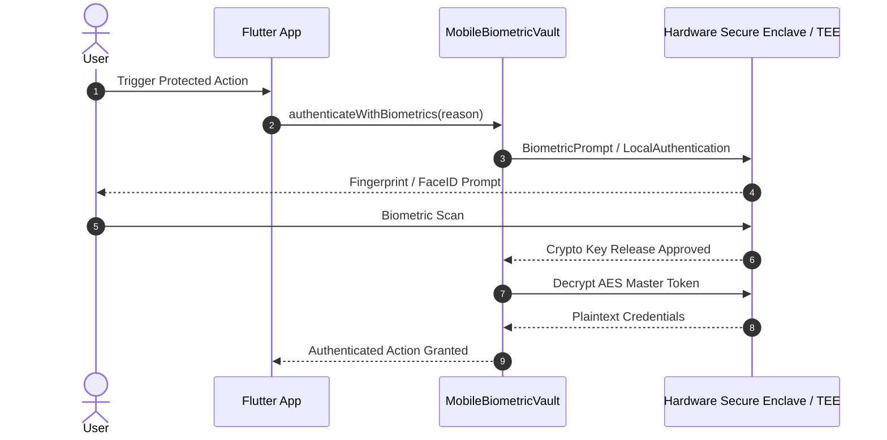

# 🛡️ flutter-biometric-vault

[](LICENSE)
[](https://github.com/MobileConduit)
[](https://github.com/MobileConduit/flutter-biometric-vault/actions)

Biometric hardware-backed secure storage wrapper for Flutter, integrating Android Keystore and iOS Keychain encryption with Face ID / Fingerprint gating.

## 🏗️ Hardware Cryptographic Gating



## 🚀 Usage

```dart
final vault = MobileBiometricVault();

// Prompt user for fingerprint / face verification
final authenticated = await vault.authenticateWithBiometrics("Authorize Transaction");

if (authenticated) {
  final token = await vault.readSecureToken("session_token");
}
```

---

## 👤 Author & Maintainer

**Eng. MHD. Shadi AL-Hasan**  
- **Role:** Executive CTO & Enterprise Solutions Architect  
- **Email:** [mhd.shadi.alhasan@gmail.com](mailto:mhd.shadi.alhasan@gmail.com)  
- **Phone / WhatsApp:** [+963934005922](tel:+963934005922)  
- **Location:** Damascus, Syria  
- **GitHub:** [MobileConduit](https://github.com/MobileConduit)  

---

## 📄 License

This project is licensed under the MIT License - see the [LICENSE](LICENSE) file for details.  
Copyright (c) 2026 **MHD. Shadi AL-Hasan**. All rights reserved.
